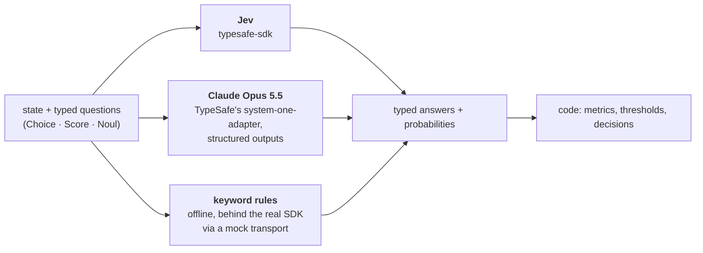

# ⚡ System One Models — Getting Started

**TypeSafe's launch post makes six claims about Jev, the first "System One model". This repo turns each one into an experiment you can run.** Jev, an LLM, and plain keyword rules all answer the *same typed questions* through the *same* `system_one(state, questions)` call, and code measures the rest: latency, tokens, cost, calibration, and whether the answers are right.

[](https://github.com/gsaini/system-one-models-getting-started/actions/workflows/ci.yml)


> An independent learning project, not affiliated with TypeSafe or Anthropic. The post is dated 2026-10-13 and this was built the next day; prices, limits, and the SDKs are changing weekly, so re-check anything you rely on.

---

## The post in one paragraph

[*Introducing System One Models & Jev*](https://typesafe.ai/blog/introducing-system-one-models-and-jev) (Diogo Almeida, TypeSafe, 2026-10-13) describes a new class of model that **doesn't generate text**. You send a *state* (text or JSON) and typed *questions*; you get back typed answers with probabilities: a **Choice** from options you listed, a **Score** on levels you described, a **Noul** (P(yes) for a statement). The post calls it *"a frontier-intelligence function call: unstructured state in, typed probabilistic decisions out,"* trained with **RLCD** ("reinforcement learning for calibrated decisions") rather than RLHF. Its claims: **parallel** evaluation of all questions in one request, **calibrated** confidence, **type safety by construction** (schema errors "mathematically impossible"), **70–500 ms** latency, **$0.042 per million input tokens** with free output, and headline workflow numbers of **193.6× faster and 444.6× cheaper** than frontier LLMs. Demos: a Doom bot on text game state, and **Wikiracing**.

## One interface, three arms



- **Jev**: the official [`typesafe-sdk`](https://docs.typesafe.ai/sdk/python). `--live`, needs `TYPESAFE_API_KEY`.
- **An LLM**: TypeSafe's own [`system-one-adapter`](https://github.com/typesafe-ai/system-one-adapter-python), a drop-in `TypeSafeClient` replacement that asks an LLM for the same typed answers, built "for comparing TypeSafe against an LLM on cost/speed/intelligence". Here it drives **Claude Opus 5.5** with schema-constrained output, asked for probability distributions, at `effort: low` by default ([why](docs/claims.md#the-llm-arm)). `--llm`, needs Anthropic credentials.
- **Keyword rules**: what a team has *before* a model, served through the real SDK so every experiment runs offline, free, in CI. **Offline numbers are the baseline, not Jev.**

## The experiments

| Claim in the post | Command | What it measures |
|---|---|---|
| "unstructured state in, typed probabilistic decisions out" | `systemone demo` | one state, 8 questions of all three kinds, one request; the typed answers, probabilities, and confidence |
| "parallel, generating all outputs in one query" | `systemone parallel` | N questions in **one** request vs **N** requests, N = 1…32: latency, tokens, whether batching changes answers; all 32 questions are labelled |
| "calibrated decisions", "epistemically honest probabilities" | `systemone calibration` | 1,000 labelled SMS messages, one Noul each: accuracy, **Brier**, **ECE**, a reliability table, AUC, a threshold sweep |
| Wikiracing: Choice over ≤255 links, "scoring independently then making an explicit choice" above that | `systemone wikirace` | 14 races on a bundled snapshot of real Wikipedia link lists: solved, hops vs shortest, decisions, two-stage decisions |
| "0% type errors", "$0.042/MTok", "70–500 ms" | every run | the per-arm table: malformed outputs, tokens, list-price cost, latency p50/p95 |
| "193.6× faster, 444.6× cheaper" | [docs/claims.md](docs/claims.md) | what that number measures, and what independent tests found |

## Quick start (offline, no keys)

```bash
git clone https://github.com/gsaini/system-one-models-getting-started.git
cd system-one-models-getting-started
uv sync                      # or: python -m venv .venv && .venv/bin/pip install -e . pytest

uv run systemone demo
uv run systemone parallel
uv run systemone calibration          # add --limit 200 for a quick look
uv run systemone wikirace
uv run pytest -q                      # 23 tests
```

Each run prints a Markdown report and saves it with the raw numbers under `runs/`.

### With Jev, and with Claude

```bash
export TYPESAFE_API_KEY=...                       # https://console.typesafe.ai/keys
uv run systemone calibration --live --yes         # 1,000 Jev requests ≈ $0.005 at list price
uv run systemone wikirace --live --yes
uv run systemone parallel --live --yes

export ANTHROPIC_API_KEY=...                      # or: ant auth login
uv run systemone calibration --live --llm --limit 200 --yes    # Claude ≈ 60¢ at low effort for 200
uv run systemone wikirace --live --llm --yes
uv run systemone demo --live --llm --effort default            # Opus 5.5's default (medium) effort
```

Live runs print a cost estimate and stop until you pass `--yes`.

## Results

### Measured offline, 2026-10-14: the keyword baseline

These show the mechanics and set the bar Jev has to clear. **They say nothing about Jev**; the Jev and Claude columns stay empty until someone runs `--live`.

**`demo`**: one request, eight typed answers, nothing to parse.

| question | type | answer | confidence | distribution |
|---|---|---|---|---|
| `next_action` | choice | **escalate_to_human** | 0.52 | reply_with_fix 0.08, offer_refund_or_credit 0.31, escalate_to_human 0.61, … |
| `churn_risk` | score | **1.99** | 0.28 | 0 0.08, 1 0.21, 2 0.35, 3 0.35 |
| `refund_requested` | noul | **0.90** | — | — |
| `mentions_competitor` | noul | **0.85** | — | — |

**`parallel`**: 32 questions in one request cost **1,272** input tokens; as 32 requests, **12,079**, because the 230-word report is re-sent each time. Batched and single answers agreed 100% (the baseline is deterministic). Latency is meaningless offline; the live run is the test of the "parallel" claim.

**`calibration`**, 1,000 messages (13% spam):

| | keyword baseline | Jev | Claude Opus 5.5 |
|---|---|---|---|
| accuracy at p ≥ 0.5 | 98.0% | *not run yet* | *not run yet* |
| precision / recall | 99.1% / 85.4% | | |
| Brier (lower is better) | 0.018 | | |
| **ECE** (lower is better) | **0.058** | | |
| AUC | 0.988 | | |
| cost at list price | $0 | ≈ $0.005 expected | |

The reliability table shows where the baseline's probabilities lie: messages it scored **0.20** were spam **6%** of the time, and messages it scored **0.45** were spam **69%** of the time. SMS spam is a keyword-friendly task, which is why the rules do well on accuracy. The interesting columns for a model that claims calibration are **Brier, ECE, and that table**.

**`wikirace`**, 14 races, shortest paths of 2–3 hops:

| | keyword baseline | Jev | Claude Opus 5.5 |
|---|---|---|---|
| solved | **2/14** | *not run yet* | *not run yet* |
| hops on solved (shortest possible) | 7 (4) | | |
| model decisions / two-stage | 36 / 0 | | |

The baseline picks by word overlap with the target's title and the races were chosen so there is none, so it ties on every option and walks to the first one alphabetically: *A Review of General Semantics*, then a dead end. A model has to know that *Nudge* is behavioural economics, that *Antifragile* is Taleb's, and that *Garry Kasparov* is one hop from *Alan Turing*.

> **Two caveats on the race.** The bundled snapshot has outgoing links for 257 pages (the two roots and everything they link to); a race may only move onto those pages, and the most any page links to among them is 163. So the **two-stage path (>255 options) never triggers on this data**; it is exercised by a unit test with 401 synthetic candidates. And Wikipedia link lists change: the snapshot's `built` field says when it was taken.

### Live results

Not run: the machine this was built on had neither key. If you run the live commands, the saved `runs/*/report.md` has the tables above with the extra columns filled; paste them here with the date and the `model` field the API reported (Jev's alias `jev-latest` resolves to a versioned ID).

## What to look at in a live run

1. **`parallel`**: does the "one request" column stay flat from N = 1 to 32 while "N single requests" grows linearly? Does batching change any answers? That is the parallel-evaluation claim, directly.
2. **`calibration`**: ECE and the reliability table, not accuracy. The post's bet is that a 0.8 is right about 80% of the time. The threshold sweep shows what a calibrated probability buys: code can set the threshold to the cost of a wrong flag and get what it asked for.
3. **The per-arm table**: `malformed retries` is the type-safety claim measured. For Jev it is zero by construction. For Claude with structured outputs it should be zero too, which is the point made in [claims.md](docs/claims.md#4-hallucination-and-type-safety): schema validity is no longer rare; first-class probabilities and parallel evaluation are the difference.
4. **Cost and latency**: Jev's list price is $42 per **billion** input tokens, so the whole calibration run is about half a cent. Compare the Claude column for the same questions, and remember the LLM arm here runs at `low` effort; the post compared against "default reasoning".

## Repository layout

```text
src/systemone/
  arms.py          Jev / LLM / baseline behind one interface; per-call latency, tokens, cost, errors
  baseline.py      keyword rules served through the real SDK over httpx2.MockTransport
  providers.py     the adapter's Anthropic provider plus `effort`
  confidence.py    TypeSafe's confidence formulas, for the baseline's answers
  data.py          the SMS sample, the Wikipedia snapshot, the races
  experiments/     demo.py · parallel.py · calibration.py · wikirace.py — run() + markdown()
  cli.py           `systemone <experiment> [--live] [--llm] [--yes]`
data/              sms_spam_sample.jsonl · wiki_snapshot.json.gz · wiki_races.json · README.md (licences)
scripts/           build_wiki_snapshot.py · pick_races.py
tests/             23 offline tests: SDK round trip, metrics on known inputs, two-stage above 255, effort provider
docs/              claims.md · how-it-was-built.md
```

## Further reading

- [docs/claims.md](docs/claims.md): each claim, what it measures, TypeSafe's own stated nuance, and the independent evidence so far.
- TypeSafe: [the post](https://typesafe.ai/blog/introducing-system-one-models-and-jev) · [docs](https://docs.typesafe.ai/) · [models & pricing](https://docs.typesafe.ai/models) · [Jev 1.13's known weak spots](https://docs.typesafe.ai/model-jaggedness/jev-1.13) · [workflow evals](https://evals.typesafe.ai/) · [system-one-adapter](https://github.com/typesafe-ai/system-one-adapter-python)
- Companion work: [jev-claude-code-case-study](https://github.com/gsaini/jev-claude-code-case-study) (Jev inside apps and inside Claude Code's loop) · study notes on [Jev + Claude Code](https://github.com/gsaini/awesome-software-engineering/blob/main/notes/jev-claude-code.md) and [Jev Ultrafast](https://github.com/gsaini/awesome-software-engineering/blob/main/notes/jev-ultrafast.md)

## License

[MIT](LICENSE). Data licences are in [data/README.md](data/README.md): the SMS Spam Collection is CC BY 4.0; Wikipedia titles and link structure are CC BY-SA 4.0.
